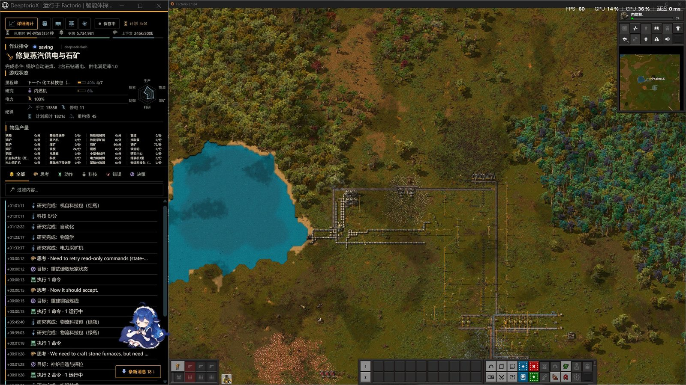

# DeeptorioX

[](https://github.com/LiveDevLiberate/DeeptorioX/actions/workflows/ci.yml)

**An evaluation harness for AI agents playing Factorio.** DeeptorioX launches the real graphical
game as a local multiplayer host, exposes a cooperative JSON gameplay API (and an importable Python
client), runs LLM agents through benchmark seeds, and records comparable runs with milestone-based
capability scoring — while keeping the evaluation itself out of the agent's context.



*Recording window beside the live game: work order, game-state readouts (milestones, research, power, discipline), item production and the live transcript.*

## Highlights

- **Real game, real constraints** — the full graphical client hosts a private local multiplayer
  session; the agent walks, mines, builds and researches through the same interface a player has.
  No dedicated server, no second machine, no teleporting.
- **Cooperative gameplay API** — `factorio.py` and `POST /api/agent/*` for observations and
  serialized action jobs, plus an optional MCP server and a Gym-style environment.
- **Multiple agent backends** — OpenCode (default), Codex (`--agent codex`) and DeepSeek Harness
  (`--agent dsh`), all normalized into one transcript format.
- **Benchmarks and scoring** — versioned seeds and milestone definitions; scoring v2 ranks
  capability (0–1000, time-normalized against a par) and reports discipline metrics separately.
- **Recording by default** — standalone recording window with live transcript, plan readout and
  telemetry; run detail and comparison pages; optional OBS timelapses and window screenshots.
- **Parallel evaluation cluster** — isolated manager/game ports and data directories for
  concurrent benchmark runs.

## Quick start

Requirements: the full Factorio game (Steam; the demo and dedicated servers are not supported),
Node.js 20+, Python 3, and an agent CLI (OpenCode by default) or a DeepSeek API key for DSH.
Open Steam and sign in before launching.

```bash
npm ci
npm run build
./autorio start smoke          # macOS / Linux
autorio.cmd start smoke        # Windows (PowerShell or cmd.exe)
```

The manager listens on `http://127.0.0.1:3000`, opens the recording window and stays running after
the run. Use `./autorio shutdown` before restarting with changed code. `npm run doctor` checks the
local toolchain (Factorio, agent CLI, Python, browser).

| Command | Purpose |
| --- | --- |
| `./autorio start <benchmark>` | Build if needed, start manager + game, launch the agent |
| `./autorio list` / `show` / `watch` / `stop` | Inspect and control runs |
| `./autorio compare` | Compare selected runs |
| `npm run cluster -- <start\|status\|run\|stop\|logs>` | Parallel evaluation cluster |
| `npm run mcp` | MCP stdio server over the gameplay API |

See the [user manual](docs/user-manual.md) for Windows notes, agent/model configuration, TTS
narration, OBS timelapses, quota handling and every environment variable.

## Benchmarks

| Benchmark | Objective | Scoring |
| --- | --- | --- |
| `smoke` | Craft one iron gear wheel (connectivity + scoring check) | unranked, par 15 s |
| `automation` | Build a working iron smelting setup and produce 20 new plates | ranked, par 641 s (provisional) |
| `rocket` | Launch a rocket in base Factorio | ranked, 7 milestones, par 9600 s (provisional) |

Benchmark JSON files under [`benchmarks/`](benchmarks) define seed, task text, starting inventory,
time limit, milestones and the `scoring` block (`par_seconds`, `progress_weights`,
`completion_basis`, `ranked`).

## Evaluation model

Scoring v2 separates two things that were previously mixed:

- **Capability (0–1000, ranked)** — computed from milestone first-seen times. Completed runs score
  `round(500 + 500 * r / (1 + r))` with `r = par_seconds / completion_seconds`; unfinished runs
  score `min(499, round(499 * weighted progress))`.
- **Discipline (report-only)** — manual mining/crafting, blackouts, ignored alerts, late STATE.md,
  refactor debt and related flags. It never changes the capability rank.

The evaluation is **operator-only**: `/api/agent/*` responses, prompts and the playbook never expose
the score. Calibrate par values from recorded runs with
`node scripts/calibrate-scoring.mjs --data-dir <runs> [--apply]`; the full design lives in
[docs/evaluation-scoring-spec.md](docs/evaluation-scoring-spec.md).

## Recording and operator pages

The standalone recording window renders the live transcript (collapsed reasoning summaries, action
rows, turn dividers, filters) with a readout table: milestone progress (bar + percent + next
milestone), research progress, power and discipline records. `?overlay=1` gives a clean OBS
overlay. Each finished run also has a run page (`run.html`) with production graphs, milestone
timings, scoring and the agent's blueprint catalogue, plus a side-by-side comparison page
(`compare.html`).

## Repository layout

| Path | Contents |
| --- | --- |
| `src/` | TypeScript manager: HTTP API, run lifecycle, agents, scoring, recording, OBS |
| `public/` | Recording window, run/compare pages, CSS modules, icons, transcript view model |
| `factorio.py`, `autorio_gym.py`, `autorio_types.py` | Python gameplay client, Gym environment, typed observations |
| `benchmarks/` | Versioned benchmark seeds and scoring configuration |
| `runs/run_template/` | Agent playbook (`AGENTS.md`) and design cookbook (`COOKBOOK.md`) |
| `factorio-mod/autorio-control/` | Native control Lua mod (walking, mining, polling) |
| `native/`, `src/vision.ts` | macOS recording window / timelapse helpers and screenshot capture |
| `scripts/`, `tests/` | Build, packaging, release, cluster tooling and the Node/Python test suites |
| `docs/` | User manual, architecture, scoring and construction specs |

## Documentation

- [User manual](docs/user-manual.md) — setup, configuration, agents, OBS, quotas
- [Architecture](docs/architecture.md) — internals, process topology, API design
- [Evaluation scoring spec](docs/evaluation-scoring-spec.md) — capability/discipline model
- [Construction architecture](docs/construction-architecture-spec.md) — planned/free building modes
- [Agent capability plan](docs/agent-capability-plan.md) — roadmap for agent-facing features
- [MCP tools](docs/mcp-tools.md) and [map preview](docs/map-preview.md)
- [CHANGELOG](CHANGELOG.md) and [contributing guide](CONTRIBUTING.md)

## Development

```bash
npm ci
npm run verify          # build + Node tests + Python tests + repo hygiene + Prettier + ESLint
npm run test            # build + test suites only
npm run lint
npm run format
npm run tools:manifest  # regenerate public/tool-manifest.json after API changes
npm run coverage        # coverage gate (82% lines / 78% branches / 84% functions)
```

Install the fast pre-commit hook with `npm run hooks:install` (repo hygiene, format check and
typecheck). CI mirrors the full verify gate on Ubuntu and Windows.

## Contributing

Read [CONTRIBUTING.md](CONTRIBUTING.md) before changing the manager, the agent API or the recording
UI. Keep the agent-facing surface cooperative and free of evaluation data, keep reasoning heuristics
in the DOM-free `public/transcript-view-model.js`, and run `npm run verify` before committing.

## Acknowledgements

DeeptorioX is a fork of [autorio](https://github.com/ryanmadden/autorio) by Ryan Madden and
contributors. Icons under `public/icons/` come from [game-icons.net](https://game-icons.net) and are
covered by their attribution file.

## License

No license has been declared for this repository yet. Upstream `autorio` also ships without a
license file, so redistribution should be treated as pending until licensing is clarified. Open an
issue if you need to use this code.
